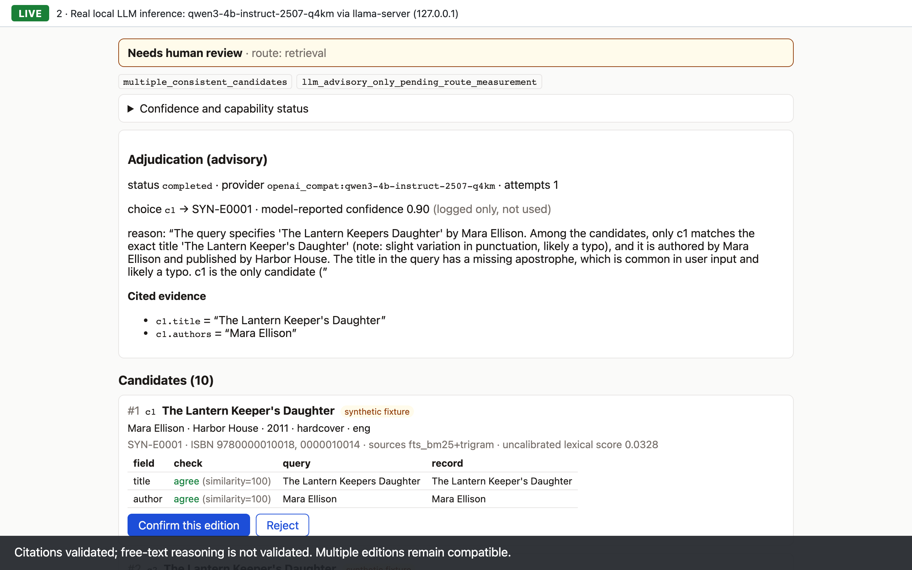
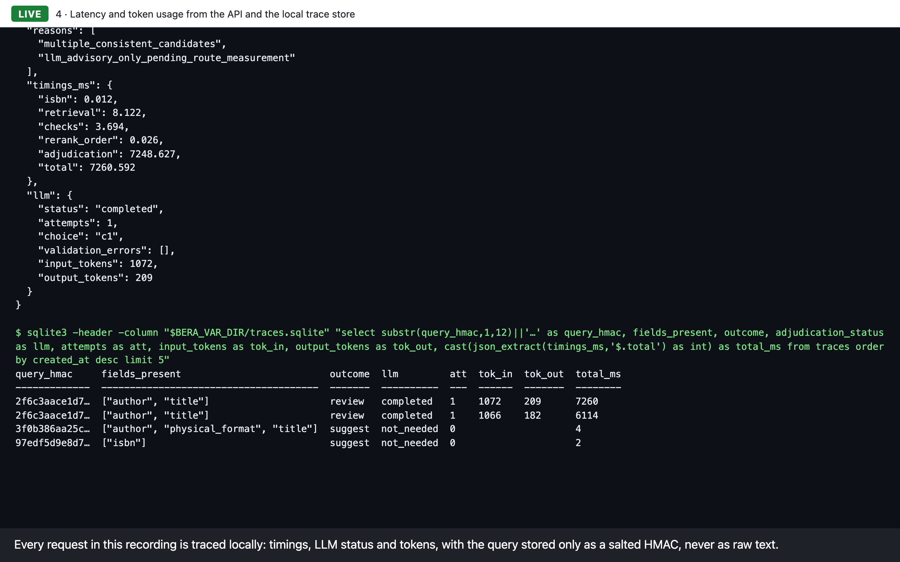

# Book Edition Resolution Assistant (BERA)

[](https://github.com/omerbar4/book-edition-resolution-assistant/actions/workflows/ci.yml)

**Hybrid retrieval with a schema-validated, evaluation-gated LLM adjudicator.**

Given an ISBN or an incomplete book description, BERA suggests the most likely Open Library
**edition** or routes the case to **human review**. Retrieval (BM25, trigram and optional
embeddings, fused with RRF) and deterministic field checks make every decision. When several
editions still fit, a local LLM (Qwen3-4B via llama.cpp) must answer in a strict JSON schema
and cite record fields, and code checks each citation against the stored record. The model
stays **advisory** unless dev evidence clears a gate fixed in advance: at least 30 cases and a
95% Wilson lower confidence bound of at least 0.95. It has not. On held-out data the system
made 0/40 wrong suggestions while covering 6/15 answerable queries; all seven configurations
made identical decisions, so the LLM showed no measured accuracy gain.

It is decision support only: it never creates listings, changes prices, calls external
services or makes irreversible decisions.

## Walkthrough (synthetic catalog only)

A [2 min 24 s recorded walkthrough](docs/presentation/bera-walkthrough.webm) (WebM; GitHub
does not play it inline, so download it or use "View raw") shows deterministic resolution, a real local Qwen3-4B call with validated evidence
and an advisory outcome, mock security tests, latency and token traces, and the recorded r2
results. Each segment is labeled **LIVE**, **MOCK** or **RECORDED**; see
[docs/presentation](docs/presentation/README.md).

| | |
|---|---|
|  |  |
| **LIVE:** Qwen3-4B picks c1; its citations pass validation, but its free-text reasoning is not validated (it wrongly says only c1 matches) and several editions remain compatible, so the outcome stays review | **LIVE:** per-stage latency and token usage from the API and the local trace store |

> **Status (2026-11-08).** The evaluation milestone is complete: 100 human-reviewed labels
> (60 dev, 40 held-out), a full-system freeze, and one scored held-out run. Confidence is
> **uncalibrated**, and the local LLM is **advisory only** (both of its suggestion gates are
> closed). See [docs/EVALUATION_REPORT.md](docs/EVALUATION_REPORT.md) and
> [docs/STATUS.md](docs/STATUS.md).
>
> **`main` contains post-evaluation changes** (a dependency fix, the health-status text, a
> test timeout, docs and a demo). It no longer matches the evaluated snapshot, tag
> `bera-eval-freeze-2026-11-07-r2`, and `freeze_manifest.py verify` fails on `main` by design.
> The held-out numbers below describe the tagged snapshot.
>
> **Release `v0.1.0`** is cut from `main`. Its held-out measurements belong to
> `bera-eval-freeze-2026-11-07-r2`; the code in `v0.1.0` adds the documented post-evaluation
> fixes, which were **not** re-evaluated on held-out data.

## Held-out result (40 queries, 39 families, one labeler)

The run used frozen tag `bera-eval-freeze-2026-11-07-r2` with policy `conservative-rules-v2`.

| metric | k / n | 95% Wilson (case level) | 95% bootstrap (family grouped) |
|---|---|---|---|
| wrong suggestions (observed) | **0 / 40** | 0.0–8.8% | 0.0–0.0% |
| correct suggestions, answerable queries | **6 / 15** | 19.8–64.3% | 16.7–66.7% |
| correct suggestions, all queries | 6 / 40 | 7.1–29.1% | 5.0–27.5% |
| error among suggestions | 0 / 6 | 0.0–39.0% | – |
| review when the human chose review | 25 / 25 | 86.7–100% | – |
| top-1 is the human's edition (answerable) | 14 / 15 | 70.2–98.8% | 78.6–100% |

- **What 0 wrong means:** no wrong suggestion was observed in 40 queries. That is not zero
  risk. With only 6 suggestions, the error rate among suggestions is barely constrained
  (upper bound 39%).
- **Coverage:** the system is conservative. 9 of the 15 answerable queries went to review.
- **Same decisions everywhere:** all seven configurations made identical final decisions on
  every query: exact/fuzzy, BM25, BM25+trigram (default), embedding, hybrid, hybrid+reranker,
  and hybrid+reranker+routed LLM. The decision checks limit coverage, not retrieval
  (recall@5 = 15/15).
- **The LLM:** it was invoked on 17 queries and picked a candidate 11 times. Only 2 of those
  picks matched the human's answer, and 9 were on cases the human sent to review. Its picks
  changed no decision, because both suggestion gates are closed. This is **not** evidence
  that the LLM improves quality.
- **Comparison with dev (60 cases):** 28/43 answerable correct, 0/60 wrong. The dev labels
  informed policy v2, so dev is not an independent test; the held-out set is.

## Labels and their provenance

| group | labels | independence |
|---|---|---|
| held-out | 40 | labeled blind (proposals never shown); owner self-reports no AI assistance |
| dev, batch 02 + final | 60 | 59 used exactly as labeled. 1 (`d02-6463d76f7e`, "Darkwoods") was **amended** to human review after a catalog-record review in which the records were presented to the labeler by an assistant tool; the original line is preserved |
| batch 01 | 20 drafts | **not counted**: 6 practice labels made with outside help (excluded from evaluation), 14 drafts whose answer was exposed before labeling |

All 100 counted cases were human reviewed. Strictly independent final labels number **99**
(59 dev + 40 held-out), because the Darkwoods ruling followed an assisted catalog-record review. Independence is
self-reported by the single labeler and cannot be checked externally. Sidecar files record
provenance, exposures, skips, review flags and amendments; label decisions are never edited
(the 2026-11-09 schema migration renamed one stored value; see
[data/eval/migrations/20261109_program_drafted_origin](data/eval/migrations/20261109_program_drafted_origin/)).

## Components

| Stage | Implementation |
|---|---|
| ISBN | normalization, checksum, 10↔13, exact lookup; duplicate mappings and bad-checksum repair hypotheses always go to review |
| Retrieval | SQLite FTS5 BM25 + trigram (typo tolerant), fused with RRF (k=60); optional `BAAI/bge-small-en-v1.5` embeddings |
| Rerank | optional `cross-encoder/ms-marco-MiniLM-L6-v2` (ordering only, uncalibrated) |
| Checks | deterministic field agreement/conflict checks (title, author incl. conservative initials, format, year, publisher, language, edition, study guide / box set) |
| Policy | `conservative-rules-v2`, **uncalibrated**: unknown fields never distinguish, catalog-wide uniqueness scan |
| Adjudication | Qwen3-4B-Instruct-2507 Q4_K_M via a project-built `llama-server` on 127.0.0.1: strict schema, candidate allowlist, evidence checks, bounded attempts. **Advisory**: suggestion gates closed on dev evidence (agree 4/10, override 0/0; target 0.95, minimum 30) |
| UI | React review screen with local confirm/reject; blind-first labeling tab |
| Tracing | local SQLite; queries stored only as a salted HMAC |

## Quick start (Python 3.12, Node ≥ 20)

```bash
python3.12 -m venv .tools/venv && .tools/venv/bin/pip install uv==0.13.7
.tools/venv/bin/uv sync --locked                 # core; add --group ml for embeddings/reranker
.tools/venv/bin/uv run python -m bera.cli build-catalog   # 30 synthetic fixture editions
npm --prefix frontend ci && npm --prefix frontend run build
.tools/venv/bin/uv run python -m bera.cli serve  # http://127.0.0.1:8000
```

- **Core vs ML:** a core-only `uv sync --locked` (no torch) runs the app and the full check
  suite; the 3 ML smoke tests skip without weights. `--group ml` adds the embedding and
  reranker stack.
- **Checks:** `uv run ruff format --check . && uv run ruff check . && uv run mypy &&
  uv run pytest`. Frontend: `npm --prefix frontend run typecheck` and
  `VITE_API_BASE_URL=http://127.0.0.1:9 npm --prefix frontend test`.
- **What has been verified (2026-11-08, macOS arm64):**
  - a **fresh online install** from empty uv/pip/npm caches, core and `--group ml`;
  - an offline clean clone;
  - the Docker build and compose run;
  - core checks on GitHub Actions (ubuntu-24.04): 232 passed, 3 skipped (ML smoke tests), and
    frontend 11/11.

  See [docs/SETUP_VERIFICATION.md](docs/SETUP_VERIFICATION.md).

Local ML weights, LLM weights and the Open Library catalog are not in git. Getting them
needs owner-approved downloads (see MODEL_NOTICE.md, DATA_NOTICE.md and
[docs/SETUP_VERIFICATION.md](docs/SETUP_VERIFICATION.md)):

```bash
.tools/venv/bin/uv run python scripts/fetch_models.py --approved-by-owner
```

Docker runs the **public-demo profile** (`BERA_PUBLIC_DEMO=1`): API + UI over the committed
Open Library corpus (5,366 editions), built into the image at build time, sha256-checked and
opened read-only; the LLM is disabled and weights are never baked in. API docs, feedback,
trace-summary and labeling routes are not mounted (404); `/api/*` is rate-limited per client;
requests over 16 KB are refused even without a Content-Length header; HSTS and
Permissions-Policy are added; nothing is written to disk except `/tmp`. `/api/health` is
liveness and `/api/ready` checks the catalog against the expected corpus. `compose.yaml` binds
to 127.0.0.1:8000 and runs as uid 10001 with a read-only root filesystem, a `/tmp` tmpfs,
`no-new-privileges` and all capabilities dropped. (The 2026-11-08 verification in
SETUP_VERIFICATION.md predates this profile and used the synthetic catalog.)

```bash
docker compose up --build
```

## Demo (synthetic catalog only)

```bash
.tools/venv/bin/uv run python -m bera.cli build-catalog
.tools/venv/bin/uv run python -m bera.cli serve --port 8000     # terminal 1
.tools/venv/bin/uv run python demo/run_demo.py                  # terminal 2
```

The demo shows 6 scripted cases: two suggestions and four reasons for review (title-only
ambiguity, duplicate ISBN, bad checksum, out of corpus). For the UI walkthrough, see
[docs/DEMO.md](docs/DEMO.md). The demo never uses dev or held-out cases.

The recorded walkthrough adds the local LLM. It needs the model weights and llama-server, and
is reproduced with `demo/record_walkthrough.py`, run from an explicitly configured Playwright
environment (`BERA_PLAYWRIGHT_PYTHON`; not a project dependency); see
[docs/presentation](docs/presentation/README.md).

## Evaluation and reproducibility

```bash
.tools/venv/bin/uv run python -m bera.evalkit.run --cases <cases.jsonl> --split dev \
  --queue <frozen queue> --out <dir> [--ml] [--llm-url http://127.0.0.1:8080/v1]
```

- **Comparison:** systems 1–6 (plus the RRF default) run on identical cases. Missing
  components are reported as blocked, never simulated.
- **The held-out run** happened once, at the frozen tag. There was one documented deviation:
  `--families` pointed to a supplement adding the 2 out-of-corpus probe families, which
  affects grouping only. See
  [data/eval/heldout/RUN_PROCEDURE_DEVIATION.md](data/eval/heldout/RUN_PROCEDURE_DEVIATION.md).
  A first attempt failed at load with 0 cases scored, and that record is kept. The results
  are committed, and the frozen-system guard now refuses any further held-out run.
- **Re-checking from committed files:**
  - `uv run python scripts/freeze_manifest.py verify`: pins and closed gates. It passes on a
    checkout of the r2 tag with the local artifacts in place; it fails on `main` by design;
  - `uv run python data/eval/heldout/build_family_supplement.py --check`;
  - `uv run python data/eval/heldout/analyze_heldout_eval.py && git diff --exit-code`.
- **Labeling server:** `BERA_CATALOG_DB=… BERA_LABEL_QUEUE=<queue> BERA_LABELS=<labels>
  uv run python -m bera.cli serve`. Held-out queues are refused unless
  `BERA_LABEL_ALLOW_HELDOUT=1`. Reveal modes: `per_case`, `after_batch`, `never`.

## Docs

[evaluation report](docs/EVALUATION_REPORT.md) · [status](docs/STATUS.md) ·
[presentation](docs/presentation/README.md) ·
[demo](docs/DEMO.md) · [setup verification](docs/SETUP_VERIFICATION.md) ·
[evaluation plan](docs/EVALUATION_PLAN.md) · [freeze](docs/FREEZE.md) ·
[decision policy](docs/DECISION_POLICY.md) · [evidence spec](docs/EVIDENCE_SPEC.md) ·
[threat model](docs/THREAT_MODEL.md) · [data card](docs/DATA_CARD.md) ·
[labeling guide](docs/LABELING_GUIDE.md) ·
[requirements tracker (frozen snapshot)](docs/REQUIREMENTS_TRACKER.md) ·
[DATA_NOTICE](DATA_NOTICE.md) · [MODEL_NOTICE](MODEL_NOTICE.md)

## License

Project-authored code: MIT ([LICENSE](LICENSE)). Data and models have separate notices.
