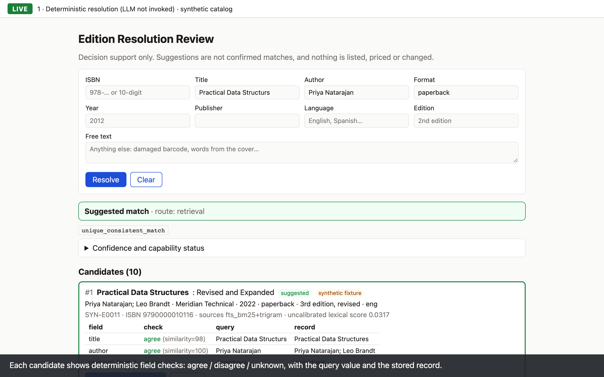
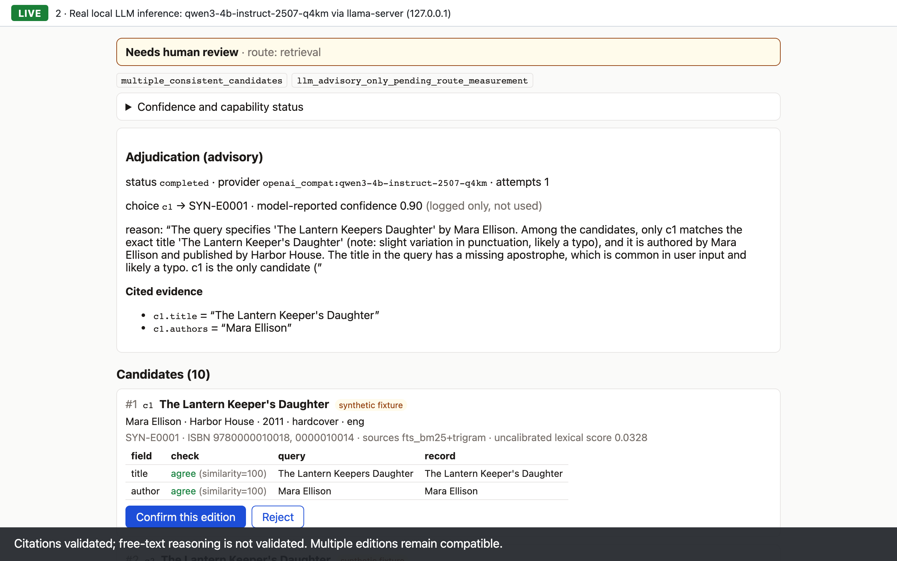
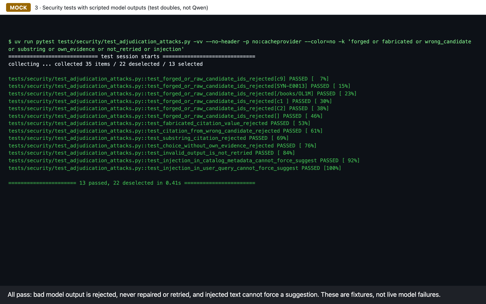
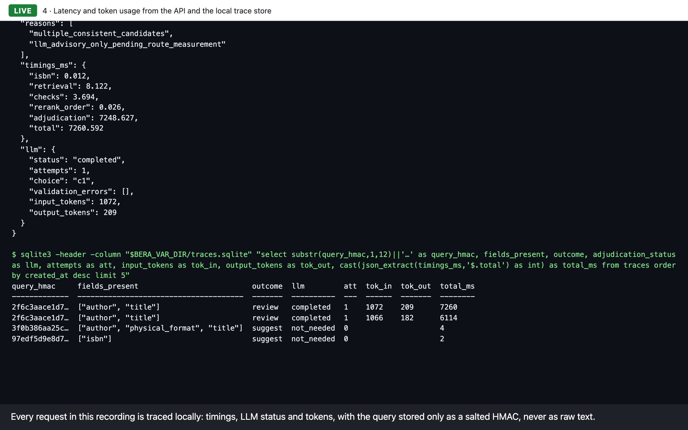

# Presentation package: recorded walkthrough and screenshots

**Hybrid retrieval with a schema-validated, evaluation-gated LLM adjudicator.**

| file | what it is |
|---|---|
| [`bera-walkthrough.webm`](bera-walkthrough.webm) | 2 min 24 s silent screen recording with captions, 1280×800 (WebM/VP8, 9.0 MB) |
| [`screenshots/`](screenshots/) | four frames captured during that recording (2560×1600) |
| [`recording_log.json`](recording_log.json) | the full API responses (including the model's output, unedited), test output and trace rows the recording showed |
| [`PORTFOLIO_DRAFTS.md`](PORTFOLIO_DRAFTS.md) | portfolio description, résumé bullets and interview answers (drafts) |
| [`../../demo/record_walkthrough.py`](../../demo/record_walkthrough.py) | the script that drove the browser and produced all of the above |

**Playback:** GitHub does not play a `.webm` file stored in a repository inline. Open the file
and use "View raw" or download it; any current browser or VLC plays it. The video is not hosted
anywhere else.

## Labels

Every frame carries one label:

- **LIVE**: the running app, its API and its trace database, queried while recording. The LLM
  step is a real call to Qwen3-4B-Instruct-2507 (Q4_K_M) through a project-built llama-server
  on 127.0.0.1. Captions are generated from the actual responses, not written in advance.
- **MOCK**: pytest security tests that feed scripted model outputs. They are test doubles, not
  the model.
- **RECORDED**: held-out numbers copied from [EVALUATION_REPORT.md](../EVALUATION_REPORT.md).
  They were measured once at tag `bera-eval-freeze-2026-11-07-r2` and nothing was re-run for
  this package.

All live input is from the 30-edition **synthetic fixture catalog**. No dev or held-out
evaluation case appears.

## Walkthrough script (as recorded)

| time | label | what is shown |
|---|---|---|
| 0:00 | – | title card, the three labels |
| 0:10 | LIVE | **Deterministic resolution, LLM not invoked.** ISBN `978-0-00-001002-5` → suggest SYN-E0002 (`unique_isbn_no_conflict`). Then `Practical Data Structurs` / Priya Natarajan / paperback → suggest SYN-E0011 (`unique_consistent_match`): BM25 + trigram retrieval fused with RRF tolerates the typo. The field-check table shows agree / disagree / unknown per field. |
| 0:28 | LIVE | **Real local LLM inference.** `The Lantern Keepers Daughter` / Mara Ellison: four editions fit every field, so the policy asks the model to choose among opaque refs c1–c5. The model answers in a strict JSON schema (choice, citations); code checks the choice against the allowlist and every cited value against the stored record. |
| 0:52 | LIVE | **Limitation, on screen:** *"Citations validated; free-text reasoning is not validated. Multiple editions remain compatible."* The model's own reason stays visible, unedited, above the caption. |
| 1:00 | LIVE | The final outcome stays **Needs human review**, because the route gate is closed. A look-alike record with hidden characters is flagged and not offered to the model. |
| 1:20 | MOCK | **Security tests:** forged candidate ids, fabricated, substring and wrong-candidate citations, a choice without its own evidence, no retry of invalid output, and injection in catalog data or the query. 13 selected tests pass. |
| 1:29 | LIVE | **Latency and tokens:** the same query through `curl … /api/resolve \| jq` shows per-stage `timings_ms` and `input_tokens` / `output_tokens`. Then `sqlite3` on the trace store shows the four recorded requests, with each query stored only as a salted HMAC. |
| 1:52 | RECORDED | **Held-out results, r2:** 0/40 wrong suggestions observed paired with 6/15 answerable coverage; all seven configurations made identical final decisions; LLM picks matched the human's answer 2 of 11 times, so there was no measured accuracy gain; the gate stays closed. |
| 2:12 | – | closing card |

## The LLM's explanation is not validated

In this recording the model picked **c1** and wrote, among other things, *"only c1 matches the
exact title"*. That statement is false: four "The Lantern Keeper's Daughter" editions match the
query equally (the outcome's reason code is `multiple_consistent_candidates`). The text also
stops mid-sentence at the schema's length limit for `decision_reason`.

- **Validated in code:** the choice (allowlist), the shape of the output (strict schema), and
  each citation, which must exactly equal the cited candidate's stored field.
- **Not validated:** the free-text reasoning and the model-reported confidence (logged only,
  never used).
- **Result:** a well-formed, correctly cited choice can still rest on a wrong explanation. That
  is why the model is advisory and the case goes to a person.

The model's output is preserved unedited in the UI frames and in
[`recording_log.json`](recording_log.json).

## What this recording actually produced (2026-11-09, `main` at `3c808ae`)

| request | outcome | LLM | tokens in / out | total ms |
|---|---|---|---|---|
| ISBN `978-0-00-001002-5` (UI) | suggest SYN-E0002 | not invoked (`not_needed`) | – | 2.5 |
| typo title + author + format (UI) | suggest SYN-E0011 | not invoked (`not_needed`) | – | 4.5 |
| Lantern Keepers, title + author (UI) | review | completed, choice c1 (SYN-E0001), 0 validation errors | 1,066 / 182 | 6,114 |
| same query (API, `curl`) | review | completed, choice c1, 0 validation errors | 1,072 / 209 | 7,260 |

In the ambiguous UI request, retrieval took 1.5 ms and the checks 4.4 ms. The local model call
took 6.1 s on one Apple-silicon Mac.

## Other notes

- **The reason code `llm_advisory_only_pending_route_measurement`** is the code's fixed name.
  The server was started with the frozen route evidence
  (`data/eval/llm_route_evidence_policy_v2_amended.json`), so the gate decision comes from
  the measured counts: agree route 4/10, with a 95% Wilson lower bound of 0.17. A route opens
  only with at least 30 cases **and** a 95% Wilson lower confidence bound of at least 0.95.
- **No live validation failure appeared** in this recording, because Qwen's output passed both
  checks. Rejections are shown with labeled test fixtures (MOCK), not with live failures.
- **Tokens are not shown in the UI.** They come from the API response and the trace store.
- **The LLM output is not fully deterministic.** Across takes at temperature 0, the choice
  stayed c1, but the reason wording and token counts varied slightly.
- **Repeated HMACs:** the same query text gives the same salted HMAC in this trace store, so
  the two Lantern rows share one.
- **Content check before publishing:** the video was sampled once per second, and the
  screenshots, the log and the metadata of every file were scanned. There were no
  credentials, local paths or content from other applications; the only URLs are 127.0.0.1
  and the public repository.

## Screenshots

| | |
|---|---|
|  |  |
| 1 · LIVE: deterministic suggestion with field checks | 2 · LIVE: Qwen3-4B adjudication with its unedited reason, validated citations, final outcome review. Caption: citations validated; free-text reasoning is not validated |
|  |  |
| 3 · MOCK: security tests with scripted outputs | 4 · LIVE: per-stage latency, tokens and the HMAC-only trace store |

## Reproduce

Running the recorder needs the local model weights and llama-server (see
[SETUP_VERIFICATION.md](../SETUP_VERIFICATION.md)), plus Playwright for Python. Playwright is
**not** a project dependency, and the recorder never installs anything. You point it at an
environment explicitly:

- `BERA_PLAYWRIGHT_PYTHON`: the Python interpreter of an environment that has Playwright.
- `--chromium-executable` or `BERA_CHROMIUM_EXECUTABLE` (optional): an existing Chrome or
  Chromium binary to use instead of Playwright's own browser.

**Optional standalone setup** (this downloads Playwright and its Chromium, and was not done for
this recording):

```bash
python3.12 -m venv .tools/presentation-venv
```

```bash
.tools/presentation-venv/bin/pip install playwright==1.63.0
```

```bash
.tools/presentation-venv/bin/python -m playwright install chromium
```

```bash
export BERA_PLAYWRIGHT_PYTHON=.tools/presentation-venv/bin/python
```

This recording used an existing local Playwright 1.63 environment and its cached Chromium,
selected through `BERA_PLAYWRIGHT_PYTHON`. Nothing was downloaded.

**Run:**

```bash
.tools/llama.cpp/build/bin/llama-server -m <Qwen3-4B-Instruct-2507-Q4_K_M.gguf> \
  --alias qwen3-4b-instruct-2507-q4km -c 8192 -ngl 99 --host 127.0.0.1 --port 8080
```

```bash
mkdir -p "$DEMO_VAR" && cp var/catalog.sqlite "$DEMO_VAR"/   # synthetic catalog, fresh traces
```

```bash
BERA_VAR_DIR="$DEMO_VAR" BERA_LLM_PROVIDER=openai_compat \
  BERA_LLM_BASE_URL=http://127.0.0.1:8080/v1 BERA_LLM_MODEL=qwen3-4b-instruct-2507-q4km \
  BERA_LLM_ROUTE_EVIDENCE=data/eval/llm_route_evidence_policy_v2_amended.json \
  .tools/venv/bin/uv run python -m bera.cli serve --port 8000
```

```bash
"$BERA_PLAYWRIGHT_PYTHON" demo/record_walkthrough.py --out docs/presentation --var-dir "$DEMO_VAR"
```

The recorder refuses to run unless the served catalog is all synthetic and the server uses the
local LLM. A new take produces new live numbers.
